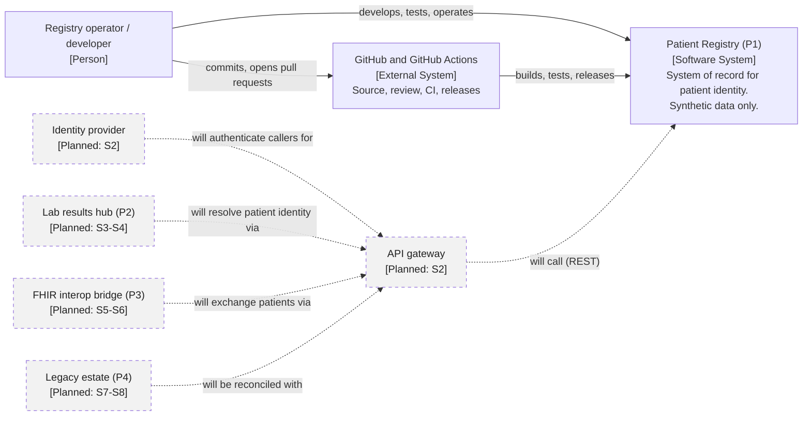

# C4 Level 1 — System Context: Patient Registry (P1)

**Version:** 0.1 · **Status:** Draft · Solid boxes exist in S1; dashed boxes are planned future systems.

## Reading the diagram

- The registry is the **only** system built in S1; GitHub supplies the CI that proves it.
- All planned systems reach the registry **through the gateway** (principle P2: contract first — the gateway
  enforces the published interface).
- Technology (IRIS, Docker, KrakenD) is intentionally absent at this level; it appears at Level 2.
